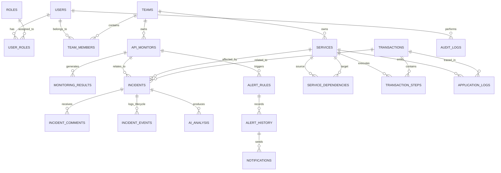

# FlowGuard AI – Database Schema & Entity Relationship Design

## 1. Entity Relationship (ER) Diagram

---

## 2. Table Specifications & Data Dictionary

### 2.1 Identity & Access Management
1. **`roles`**:
   - `id` (UUID PK)
   - `name` (VARCHAR(50) UNIQUE) -> `SUPER_ADMIN`, `ADMIN`, `ENGINEER`, `VIEWER`
   - `description` (TEXT)
   - `created_at` (TIMESTAMPTZ)
2. **`users`**:
   - `id` (UUID PK)
   - `email` (VARCHAR(255) UNIQUE NOT NULL)
   - `password_hash` (VARCHAR(255) NOT NULL)
   - `first_name` (VARCHAR(100) NOT NULL)
   - `last_name` (VARCHAR(100) NOT NULL)
   - `phone` (VARCHAR(30))
   - `is_active` (BOOLEAN DEFAULT TRUE)
   - `email_verified` (BOOLEAN DEFAULT FALSE)
   - `created_at` (TIMESTAMPTZ NOT NULL)
   - `updated_at` (TIMESTAMPTZ NOT NULL)
3. **`user_roles`**:
   - `user_id` (UUID FK -> users.id)
   - `role_id` (UUID FK -> roles.id)
   - Primary Key: `(user_id, role_id)`
4. **`teams`**:
   - `id` (UUID PK)
   - `name` (VARCHAR(100) UNIQUE NOT NULL)
   - `slug` (VARCHAR(100) UNIQUE NOT NULL)
   - `description` (TEXT)
   - `created_at` (TIMESTAMPTZ NOT NULL)
   - `updated_at` (TIMESTAMPTZ NOT NULL)
5. **`team_members`**:
   - `team_id` (UUID FK -> teams.id)
   - `user_id` (UUID FK -> users.id)
   - `role` (VARCHAR(50) NOT NULL) -> `OWNER`, `MAINTAINER`, `MEMBER`
   - `joined_at` (TIMESTAMPTZ NOT NULL)
   - Primary Key: `(team_id, user_id)`

---

### 2.2 API Monitoring Domain
6. **`api_monitors`**:
   - `id` (UUID PK)
   - `team_id` (UUID FK -> teams.id)
   - `name` (VARCHAR(150) NOT NULL)
   - `base_url` (VARCHAR(500) NOT NULL)
   - `endpoint_path` (VARCHAR(500) NOT NULL)
   - `http_method` (VARCHAR(10) NOT NULL) -> `GET`, `POST`, `PUT`, `DELETE`, `PATCH`, `HEAD`
   - `environment` (VARCHAR(50) NOT NULL) -> `PRODUCTION`, `STAGING`, `DEVELOPMENT`
   - `request_headers` (JSONB)
   - `request_body` (TEXT)
   - `auth_config` (JSONB)
   - `monitoring_interval_seconds` (INT DEFAULT 60)
   - `timeout_ms` (INT DEFAULT 5000)
   - `expected_http_status` (INT DEFAULT 200)
   - `alert_threshold_ms` (INT DEFAULT 2000)
   - `is_active` (BOOLEAN DEFAULT TRUE)
   - `current_status` (VARCHAR(20) DEFAULT 'UNKNOWN') -> `HEALTHY`, `DEGRADED`, `DOWN`, `UNKNOWN`
   - `last_checked_at` (TIMESTAMPTZ)
   - `created_at` (TIMESTAMPTZ NOT NULL)
   - `updated_at` (TIMESTAMPTZ NOT NULL)
7. **`monitoring_results`**:
   - `id` (UUID PK)
   - `monitor_id` (UUID FK -> api_monitors.id ON DELETE CASCADE)
   - `status_code` (INT NOT NULL)
   - `response_time_ms` (INT NOT NULL)
   - `is_successful` (BOOLEAN NOT NULL)
   - `error_message` (TEXT)
   - `response_headers` (JSONB)
   - `response_body_sample` (TEXT)
   - `checked_at` (TIMESTAMPTZ NOT NULL)

---

### 2.3 Microservice Registry & Topology
8. **`services`**:
   - `id` (UUID PK)
   - `team_id` (UUID FK -> teams.id)
   - `service_name` (VARCHAR(100) UNIQUE NOT NULL)
   - `service_identifier` (VARCHAR(100) UNIQUE NOT NULL)
   - `environment` (VARCHAR(50) NOT NULL)
   - `base_url` (VARCHAR(500))
   - `version` (VARCHAR(50))
   - `health_status` (VARCHAR(30) DEFAULT 'UNKNOWN') -> `HEALTHY`, `DEGRADED`, `UNHEALTHY`, `UNKNOWN`
   - `last_heartbeat` (TIMESTAMPTZ)
   - `average_latency_ms` (DOUBLE PRECISION DEFAULT 0.0)
   - `created_at` (TIMESTAMPTZ NOT NULL)
   - `updated_at` (TIMESTAMPTZ NOT NULL)
9. **`service_dependencies`**:
   - `id` (UUID PK)
   - `source_service_id` (UUID FK -> services.id ON DELETE CASCADE)
   - `target_service_id` (UUID FK -> services.id ON DELETE CASCADE)
   - `dependency_type` (VARCHAR(50) DEFAULT 'REST') -> `REST`, `KAFKA`, `GRPC`, `DATABASE`
   - `created_at` (TIMESTAMPTZ NOT NULL)

---

### 2.4 Transaction Intelligence
10. **`transactions`**:
    - `id` (UUID PK)
    - `transaction_id` (VARCHAR(100) UNIQUE NOT NULL)
    - `correlation_id` (VARCHAR(100) NOT NULL)
    - `request_id` (VARCHAR(100))
    - `transaction_status` (VARCHAR(30) NOT NULL) -> `SUCCESS`, `FAILED`, `PENDING`, `PROCESSING`
    - `start_time` (TIMESTAMPTZ NOT NULL)
    - `end_time` (TIMESTAMPTZ)
    - `total_duration_ms` (BIGINT)
    - `root_service_id` (UUID FK -> services.id)
    - `failure_reason` (TEXT)
    - `metadata` (JSONB)
    - `created_at` (TIMESTAMPTZ NOT NULL)
11. **`transaction_steps`**:
    - `id` (UUID PK)
    - `transaction_id` (UUID FK -> transactions.id ON DELETE CASCADE)
    - `service_id` (UUID FK -> services.id)
    - `step_name` (VARCHAR(150) NOT NULL)
    - `step_order` (INT NOT NULL)
    - `status` (VARCHAR(30) NOT NULL) -> `SUCCESS`, `FAILED`, `SKIPPED`
    - `duration_ms` (INT NOT NULL)
    - `error_message` (TEXT)
    - `payload_snapshot` (TEXT)
    - `executed_at` (TIMESTAMPTZ NOT NULL)

---

### 2.5 Centralized Log Management
12. **`application_logs`**:
    - `id` (UUID PK)
    - `service_id` (UUID FK -> services.id)
    - `service_name` (VARCHAR(100) NOT NULL)
    - `environment` (VARCHAR(50) NOT NULL)
    - `log_level` (VARCHAR(20) NOT NULL) -> `TRACE`, `DEBUG`, `INFO`, `WARN`, `ERROR`, `FATAL`
    - `message` (TEXT NOT NULL)
    - `trace_id` (VARCHAR(100))
    - `correlation_id` (VARCHAR(100))
    - `exception_details` (TEXT)
    - `logger_name` (VARCHAR(255))
    - `timestamp` (TIMESTAMPTZ NOT NULL)
    - `metadata` (JSONB)

---

### 2.6 Incident Management & AI RCA
13. **`incidents`**:
    - `id` (UUID PK)
    - `incident_number` (VARCHAR(50) UNIQUE NOT NULL)
    - `title` (VARCHAR(255) NOT NULL)
    - `description` (TEXT NOT NULL)
    - `severity` (VARCHAR(20) NOT NULL) -> `CRITICAL`, `HIGH`, `MEDIUM`, `LOW`
    - `status` (VARCHAR(30) NOT NULL) -> `DETECTED`, `ACKNOWLEDGED`, `INVESTIGATING`, `RESOLVED`, `CLOSED`
    - `affected_service_id` (UUID FK -> services.id)
    - `related_api_id` (UUID FK -> api_monitors.id)
    - `assigned_engineer_id` (UUID FK -> users.id)
    - `resolution_notes` (TEXT)
    - `resolved_at` (TIMESTAMPTZ)
    - `created_at` (TIMESTAMPTZ NOT NULL)
    - `updated_at` (TIMESTAMPTZ NOT NULL)
14. **`incident_comments`**:
    - `id` (UUID PK)
    - `incident_id` (UUID FK -> incidents.id ON DELETE CASCADE)
    - `user_id` (UUID FK -> users.id)
    - `comment_text` (TEXT NOT NULL)
    - `created_at` (TIMESTAMPTZ NOT NULL)
15. **`incident_events`**:
    - `id` (UUID PK)
    - `incident_id` (UUID FK -> incidents.id ON DELETE CASCADE)
    - `event_type` (VARCHAR(50) NOT NULL) -> `STATUS_CHANGE`, `SEVERITY_CHANGE`, `ASSIGNMENT`, `AI_ANALYSIS_ATTACHED`
    - `event_description` (TEXT NOT NULL)
    - `actor_id` (UUID FK -> users.id)
    - `created_at` (TIMESTAMPTZ NOT NULL)
16. **`ai_analysis`**:
    - `id` (UUID PK)
    - `incident_id` (UUID FK -> incidents.id ON DELETE CASCADE)
    - `summary` (TEXT NOT NULL)
    - `potential_root_causes` (JSONB NOT NULL)
    - `affected_services` (JSONB NOT NULL)
    - `relevant_error_patterns` (JSONB NOT NULL)
    - `recommended_investigation_steps` (JSONB NOT NULL)
    - `suggested_remediation_actions` (JSONB NOT NULL)
    - `confidence_score` (DOUBLE PRECISION NOT NULL)
    - `supporting_evidence` (TEXT)
    - `model_used` (VARCHAR(100) NOT NULL)
    - `disclaimer` (TEXT NOT NULL)
    - `created_at` (TIMESTAMPTZ NOT NULL)

---

### 2.7 Alerting & Notifications
17. **`alert_rules`**:
    - `id` (UUID PK)
    - `name` (VARCHAR(150) NOT NULL)
    - `description` (TEXT)
    - `target_type` (VARCHAR(50) NOT NULL) -> `API_MONITOR`, `SERVICE`, `TRANSACTION`
    - `target_id` (UUID)
    - `metric_type` (VARCHAR(50) NOT NULL) -> `ERROR_RATE`, `RESPONSE_TIME`, `HEALTH_CHECK`, `TRANSACTION_FAILURE`
    - `comparison_operator` (VARCHAR(10) NOT NULL) -> `>`, `<`, `>=`, `<=`, `==`
    - `threshold_value` (DOUBLE PRECISION NOT NULL)
    - `evaluation_window_minutes` (INT DEFAULT 5)
    - `severity` (VARCHAR(20) NOT NULL) -> `CRITICAL`, `HIGH`, `MEDIUM`, `LOW`
    - `is_enabled` (BOOLEAN DEFAULT TRUE)
    - `created_at` (TIMESTAMPTZ NOT NULL)
    - `updated_at` (TIMESTAMPTZ NOT NULL)
18. **`alert_history`**:
    - `id` (UUID PK)
    - `alert_rule_id` (UUID FK -> alert_rules.id ON DELETE CASCADE)
    - `triggered_value` (DOUBLE PRECISION NOT NULL)
    - `message` (TEXT NOT NULL)
    - `severity` (VARCHAR(20) NOT NULL)
    - `is_acknowledged` (BOOLEAN DEFAULT FALSE)
    - `acknowledged_by` (UUID FK -> users.id)
    - `acknowledged_at` (TIMESTAMPTZ)
    - `triggered_at` (TIMESTAMPTZ NOT NULL)
19. **`notifications`**:
    - `id` (UUID PK)
    - `user_id` (UUID FK -> users.id ON DELETE CASCADE)
    - `title` (VARCHAR(200) NOT NULL)
    - `message` (TEXT NOT NULL)
    - `type` (VARCHAR(50) NOT NULL) -> `ALERT`, `INCIDENT`, `SYSTEM`
    - `severity` (VARCHAR(20) NOT NULL)
    - `link_url` (VARCHAR(500))
    - `is_read` (BOOLEAN DEFAULT FALSE)
    - `created_at` (TIMESTAMPTZ NOT NULL)

---

### 2.8 Audit Trail
20. **`audit_logs`**:
    - `id` (UUID PK)
    - `user_id` (UUID FK -> users.id)
    - `user_email` (VARCHAR(255))
    - `action` (VARCHAR(100) NOT NULL)
    - `resource_type` (VARCHAR(100) NOT NULL)
    - `resource_id` (VARCHAR(100))
    - `ip_address` (VARCHAR(50))
    - `user_agent` (VARCHAR(500))
    - `details` (JSONB)
    - `timestamp` (TIMESTAMPTZ NOT NULL)

